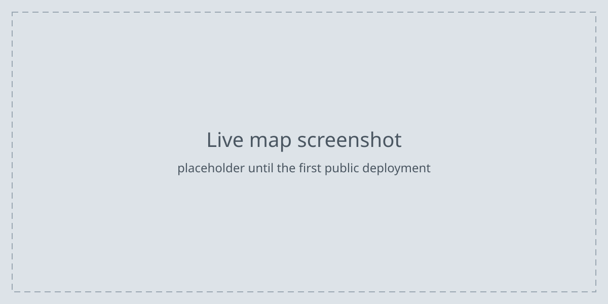
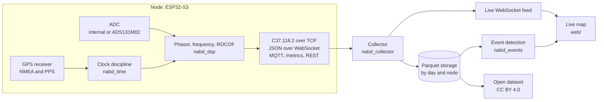

# Nabd

Nabd is an open network of low-cost GPS-synchronized ESP32 nodes that measure power grid frequency, rate of change of frequency (ROCOF), and voltage synchrophasors, with a collector server, a live map, and an open dataset.

[](https://github.com/OWNER/nabd/actions/workflows/ci.yml)
[](https://github.com/OWNER/nabd/actions/workflows/compliance.yml)
[](https://github.com/OWNER/nabd/releases)
[](#license)
[](https://doi.org/10.5281/zenodo.0000000)

> **Status:** pre-release. The repository contains the build, test, and CI scaffold. Measurement firmware, collector, and map are under development; see [CHANGELOG.md](CHANGELOG.md).



**[Flash a node from your browser](https://OWNER.github.io/nabd/flash/)** using Chrome or Edge and a USB cable. The flasher becomes available with the first firmware release.

## What a node measures

Each node samples the voltage of a wall outlet through an isolated AC adapter, timestamps the samples against GPS time, and reports at 10, 25, or 50 frames per second, aligned to UTC second boundaries:

- frequency in Hz
- ROCOF in Hz/s
- voltage synchrophasor: magnitude and phase angle relative to a UTC-synchronized cosine at nominal frequency, as defined in IEEE C37.118.1-2011
- quality flags: GPS lock lost, holdover, ADC clipping, data invalid

| Quantity (steady state, 45 to 55 Hz) | Tier A target | Tier B target | IEEE C37.118.1 P-class limit |
| --- | --- | --- | --- |
| Frequency error (FE) | 5 mHz | 1 mHz | 5 mHz |
| ROCOF error (RFE) | 0.1 Hz/s | 0.02 Hz/s | 0.01 Hz/s; 0.4 Hz/s with harmonic distortion (C37.118.1a-2014) |
| Total vector error (TVE), after adapter calibration | 1 % | 0.5 % | 1 % |
| Time error relative to UTC, GPS locked | 2 µs | 1 µs | none; 1 µs is 0.018 degrees at 50 Hz |

These are design targets and are not yet verified. The estimation algorithm is required to meet every P-class limit on the synthetic test signals in [compliance/](compliance/), which apply the steady-state limits from 45 to 55 Hz, wider than the 2 Hz deviation from nominal that P class requires. The tier targets add ADC noise, AC adapter, and timing errors on real hardware.

- **Tier A (workshop build):** ESP32-S3-DevKitC-1, NEO-6M or NEO-M8N GPS with PPS output, AC adapter front end, ESP32-S3 internal 12-bit ADC sampled by DMA.
- **Tier B (precision):** Tier A plus a TI ADS131M02 simultaneous-sampling 24-bit delta-sigma ADC on SPI, with each data-ready edge timestamped against the GPS-disciplined clock.

## Safety

**Nodes never connect directly to mains.** The only path to the grid is a certified 9 V AC-AC wall adapter, which is an isolating transformer with an AC output. The node measures the adapter's low-voltage secondary through a resistor divider and a midscale bias network. Nothing in this project requires opening an adapter, an outlet, or a distribution board.

- Use only adapters marked as safety isolating transformers (IEC 61558-2-6) or listed as Class 2 transformers (UL 5085-3), with an AC output. DC adapters and electronic halogen lamp transformers do not work and must not be used.
- Do not modify the adapter, and do not use one with a damaged case or cord.
- Do not substitute a higher-voltage adapter without recalculating the divider in [docs/hardware.md](docs/hardware.md).
- Contributions that add any direct mains connection, such as transformerless sensing, resistive droppers, or shunts, are not accepted.

## Privacy

Each node has a GPS receiver and therefore knows its exact position. Public outputs, which are the live map, the public WebSocket feed, MQTT summaries, and the published dataset, carry coordinates rounded to city level (0.1 degree, about 11 km north to south). Exact coordinates stay private to the node owner and the collector administrator and are never published. Node registration asks only for city and country. See [docs/privacy.md](docs/privacy.md).

## Bill of materials

Indicative single-unit prices in USD; the full list with example part numbers is in [hardware/BOM.csv](hardware/BOM.csv).

| Build | Main parts | Estimated cost |
| --- | --- | --- |
| Tier A | ESP32-S3-DevKitC-1, NEO-M8N GPS with PPS and active antenna, 9 V AC-AC adapter, shield PCB, front-end passives, USB power supply | about 59 USD |
| Tier B | Tier A plus ADS131M02, 8.192 MHz oscillator, and supporting passives | about 66 USD |

## Quick start

Build and test everything from source on Linux or macOS (on Windows, activate with `.venv\Scripts\activate`):

```bash
git clone https://github.com/OWNER/nabd.git
cd nabd
python -m venv .venv
source .venv/bin/activate
pip install -e ".[dev]" -r firmware/requirements.txt
pytest
cd firmware
pio test -e native
pio run -e tier_a
```

## Architecture



| Path | Contents |
| --- | --- |
| [firmware/](firmware/) | PlatformIO and ESP-IDF firmware with host-testable libraries |
| [server/](server/) | Collector and event detection (Python, asyncio) |
| [web/](web/) | Live map (TypeScript, Vite, MapLibre GL) |
| [tools/](tools/) | `nabd` command-line tool |
| [compliance/](compliance/) | Synthetic IEEE C37.118.1 test signals and TVE, FE, RFE harness |
| [dataset/](dataset/) | Dataset format and datasheet |
| [hardware/](hardware/) | KiCad shield, bill of materials, wiring |
| [docs/](docs/) | Documentation site, including the workshop guide |

## Host a node

1. Open a [node registration issue](https://github.com/OWNER/nabd/issues/new?template=node_registration.yml) with your city and country. Do not post your address or coordinates.
2. Build a node with the workshop guide, or build one at a workshop.
3. Flash the firmware from your browser.
4. Join the node's setup WiFi network and enter your WiFi credentials and the node token that the collector administrator sends you privately.
5. Place the GPS antenna where it can see the sky, plug the AC adapter into an outlet, and power the node over USB.
6. Find your node on the live map.

Steps 3 to 6 depend on firmware and collector features that are under development.

## Dataset and citation

Published measurements are daily Parquet files partitioned by day and node, with JSON metadata and a datasheet, released under CC BY 4.0. The format is specified in [dataset/](dataset/).

If you use Nabd software, hardware, or data, please cite it using [CITATION.cff](CITATION.cff). GitHub shows a "Cite this repository" button generated from that file. The DOI badge above is a placeholder until the first archived release.

## Contributing

Contributions are welcome. Read [CONTRIBUTING.md](CONTRIBUTING.md) for the development setup, style rules, and commit conventions, and [CODE_OF_CONDUCT.md](CODE_OF_CONDUCT.md). Report security issues as described in [SECURITY.md](SECURITY.md).

## License

| Part | License | File |
| --- | --- | --- |
| Firmware, server, web, tools, compliance harness, documentation | MIT | [LICENSE](LICENSE) |
| Hardware design files in `hardware/` | CERN-OHL-P-2.0 | [hardware/LICENSE](hardware/LICENSE) |
| Dataset files and documentation in `dataset/` | CC BY 4.0 | [dataset/LICENSE](dataset/LICENSE) |
| Code of conduct | CC BY-SA 4.0, adapted from the Contributor Covenant 3.0 | [CODE_OF_CONDUCT.md](CODE_OF_CONDUCT.md) |
