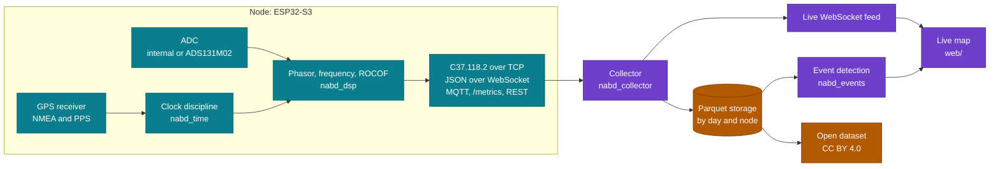

<div align="center">

<picture>
  <source media="(prefers-color-scheme: dark)" srcset="https://raw.githubusercontent.com/akeanti/nabd/main/docs/assets/readme/hero-dark.svg">
  
</picture>

**An open network of low-cost GPS-synchronized ESP32 nodes that measure power grid frequency, ROCOF, and voltage synchrophasors, with a collector server, a live map, and an open dataset.**

[](https://github.com/akeanti/nabd/actions/workflows/ci.yml)
[](https://github.com/akeanti/nabd/actions/workflows/compliance.yml)
[](https://github.com/akeanti/nabd/actions/workflows/codeql.yml)
[](https://scorecard.dev/viewer/?uri=github.com/akeanti/nabd)
[](https://github.com/akeanti/nabd/releases)
[](#license)
[](#dataset-and-citation)

[](firmware/)
[](firmware/platformio.ini)
[](pyproject.toml)
[](web/)
[](hardware/)
[](https://akeanti.github.io/nabd/)

[Measurements](#what-a-node-measures) · [Safety](#safety) · [Privacy](#privacy) · [Hardware](#bill-of-materials) · [Quick start](#quick-start) · [Architecture](#architecture) · [Host a node](#host-a-node) · [Data](#dataset-and-citation) · [Contributing](#contributing)

</div>

> [!NOTE]
> **Status: pre-release.** The repository holds the groundwork: build system, CI/CD, documentation, safety analysis, and the hardware plan. Measurement firmware, collector, and live map are in development; see the [roadmap](#roadmap) and the [changelog](CHANGELOG.md).

<p align="center">
  <picture>
    <source media="(prefers-color-scheme: dark)" srcset="https://raw.githubusercontent.com/akeanti/nabd/main/docs/assets/readme/live-map-dark.svg">
    
  </picture>
</p>

<p align="center">
  <a href="https://akeanti.github.io/nabd/flash/">
    <picture>
      <source media="(prefers-color-scheme: dark)" srcset="https://raw.githubusercontent.com/akeanti/nabd/main/docs/assets/readme/flash-button-dark.svg">
      
    </picture>
  </a>
  <br>
  <sub>Chrome or Edge on a desktop computer and a USB cable. Firmware appears in the flasher with the first release.</sub>
</p>

## What a node measures

Each node samples the voltage of a wall outlet through an isolated AC adapter, timestamps the samples against GPS time, and reports at 10, 25, or 50 frames per second, aligned to UTC second boundaries.

| Quantity | Unit | Meaning |
| --- | --- | --- |
| Frequency | Hz | rate of change of the phasor angle, plus the nominal frequency |
| ROCOF | Hz/s | rate of change of frequency |
| Voltage synchrophasor | V and degrees | magnitude and angle against a UTC-synchronized cosine at nominal frequency, as defined in IEEE C37.118.1-2011 |
| Quality flags | STAT word bits | GPS lock lost, holdover, ADC clipping, data invalid |

<p align="center">
  <picture>
    <source media="(prefers-color-scheme: dark)" srcset="https://raw.githubusercontent.com/akeanti/nabd/main/docs/assets/readme/synchrophasor-dark.svg">
    
  </picture>
</p>

| Quantity (steady state, 45 to 55 Hz) | Tier A target | Tier B target | IEEE C37.118.1 P-class limit |
| --- | --- | --- | --- |
| Frequency error (FE) | 5 mHz | 1 mHz | 5 mHz |
| ROCOF error (RFE) | 0.1 Hz/s | 0.02 Hz/s | 0.01 Hz/s; 0.4 Hz/s with harmonic distortion (C37.118.1a-2014) |
| Total vector error (TVE), after adapter calibration | 1 % | 0.5 % | 1 % |
| Time error relative to UTC, GPS locked | 2 µs | 1 µs | none; 1 µs is 0.018 degrees at 50 Hz |

These are design targets and are not yet verified. The estimation algorithm is required to meet every P-class limit on the synthetic test signals in [compliance/](compliance/), which apply the steady-state limits from 45 to 55 Hz, wider than the 2 Hz deviation from nominal that P class requires. The tier targets add ADC noise, AC adapter, and timing errors on real hardware.

<details>
<summary><b>How TVE, FE, and RFE are defined</b></summary>

For a measured phasor $\hat{X}$ and the true phasor $X$ at the same instant, IEEE C37.118.1-2011 defines

$$
\mathrm{TVE} = \sqrt{\frac{(\hat{X}_r - X_r)^2 + (\hat{X}_i - X_i)^2}{X_r^2 + X_i^2}}
\qquad
\mathrm{FE} = \left| f_{\mathrm{true}} - f_{\mathrm{measured}} \right|
\qquad
\mathrm{RFE} = \left| \mathrm{ROCOF}_{\mathrm{true}} - \mathrm{ROCOF}_{\mathrm{measured}} \right|
$$

A timing error $\Delta t$ alone gives $\mathrm{TVE} = 2 \sin(\pi f_0 \Delta t)$. One microsecond at 50 Hz is 0.031 % TVE, and the 1 % limit corresponds to 31.8 µs at 50 Hz and 26.5 µs at 60 Hz.

</details>

- **Tier A (workshop build):** ESP32-S3-DevKitC-1, NEO-6M or NEO-M8N GPS with PPS output, AC adapter front end, ESP32-S3 internal 12-bit ADC sampled by DMA.
- **Tier B (precision):** Tier A plus a TI ADS131M02 simultaneous-sampling 24-bit delta-sigma ADC on SPI, with each data-ready edge timestamped against the GPS-disciplined clock.

## Safety

> [!CAUTION]
> **Nodes never connect directly to mains.** Voltage sensing uses only a certified isolated 9 V AC-AC wall adapter, a resistor divider, and a midscale bias network. Nothing in this project requires opening an adapter, an outlet, or a distribution board.

<p align="center">
  <picture>
    <source media="(prefers-color-scheme: dark)" srcset="https://raw.githubusercontent.com/akeanti/nabd/main/docs/assets/readme/signal-chain-dark.svg">
    
  </picture>
</p>

- Use only adapters marked as safety isolating transformers (IEC 61558-2-6) or listed as Class 2 transformers (UL 5085-3), with an AC output. DC adapters and electronic halogen lamp transformers do not work and must not be used.
- Do not modify the adapter, and do not use one with a damaged case or cord.
- Do not substitute a higher-voltage adapter without recalculating the divider in [docs/hardware.md](docs/hardware.md).
- Contributions that add any direct mains connection, such as transformerless sensing, resistive droppers, or shunts, are not accepted.

## Privacy

> [!IMPORTANT]
> Public outputs round node coordinates to city level. Exact coordinates stay private to the node owner and the collector administrator.

Each node has a GPS receiver and therefore knows its exact position. The live map, the public WebSocket feed, MQTT summaries, and the published dataset carry coordinates rounded to 0.1 degree, about 11 km north to south. Node registration asks only for city and country. See [docs/privacy.md](docs/privacy.md).

## Bill of materials

Indicative single-unit prices in USD, generated from [hardware/BOM.csv](hardware/BOM.csv). The enclosure is optional and not included in the totals.

<!-- bom:start -->
| Build | Estimated cost |
| --- | ---: |
| Tier A, workshop build | 58.74 USD |
| Tier B, precision build | 65.74 USD |

<details>
<summary>Every item in <code>hardware/BOM.csv</code></summary>

| Tier | Quantity | Reference | Part | Example | Line cost (USD) |
| --- | ---: | --- | --- | --- | ---: |
| common | 1 | U1 | ESP32-S3 development board, 8 MB flash | Espressif ESP32-S3-DevKitC-1-N8 | 15.00 |
| common | 1 | U2 | GPS receiver breakout with PPS output | u-blox NEO-M8N breakout | 12.00 |
| common | 1 | ANT1 | Active GPS antenna with cable and adapter for the receiver connector | 28 dB active antenna, 3 m cable | 7.00 |
| common | 1 | PS1 | 9 V AC-AC wall adapter: safety isolating transformer with AC output | Triad Magnetics WAU09-1000 | 12.00 |
| common | 1 | J1 | DC barrel jack, 2.1 mm, through-hole | CUI Devices PJ-102AH | 0.80 |
| common | 1 | R1 | Resistor 100 kOhm 1% 0.25 W metal film |  | 0.10 |
| common | 1 | R2 | Resistor 5.6 kOhm 1% 0.25 W metal film |  | 0.10 |
| common | 2 | R3 R4 | Resistor 10 kOhm 1% 0.25 W metal film |  | 0.20 |
| common | 1 | C1 | Capacitor 470 uF 10 V electrolytic, radial |  | 0.30 |
| common | 1 | C2 | Capacitor 100 nF 50 V ceramic X7R |  | 0.10 |
| common | 1 | C3 | Capacitor 1 nF 50 V ceramic C0G |  | 0.10 |
| common | 2 | D1 D2 | Schottky diode 30 V, DO-35 | Vishay BAT85 | 0.24 |
| common | 1 | PCB1 | Nabd shield PCB, 2 layers |  | 2.00 |
| common | 2 | J2 J3 | Female header 1x22, 2.54 mm |  | 1.20 |
| common | 1 | J4 | Female header 1x6, 2.54 mm |  | 0.30 |
| common | 3 | JP1 JP2 JP3 | Pin header 1x3, 2.54 mm, with jumper cap |  | 0.30 |
| common | 1 | PS2 | USB power supply 5 V 1 A with USB cable |  | 7.00 |
| B | 1 | U3 | 24-bit 2-channel simultaneous-sampling delta-sigma ADC, TSSOP-20 | Texas Instruments ADS131M02IPWR | 4.50 |
| B | 1 | Y1 | Oscillator 8.192 MHz, 3.3 V CMOS output |  | 1.50 |
| B | 6 | C4 C5 C6 C7 C8 C9 | Decoupling and regulator capacitors per ADS131M02 datasheet |  | 0.60 |
| B | 2 | R5 R6 | Resistor 1 kOhm 1%, ADC input filter |  | 0.20 |
| B | 2 | C10 C11 | Capacitor 10 nF C0G, ADC input filter |  | 0.20 |
| optional | 1 |  | Enclosure |  | 5.00 |

</details>
<!-- bom:end -->

## Quick start

Build and test everything from source on Linux or macOS:

```bash
git clone https://github.com/akeanti/nabd.git
cd nabd
python -m venv .venv
source .venv/bin/activate
pip install -e ".[dev]" -r firmware/requirements.txt
pytest
cd firmware
pio test -e native
pio run -e tier_a
```

<details>
<summary>Windows (PowerShell)</summary>

```powershell
git clone https://github.com/akeanti/nabd.git C:\src\nabd
cd C:\src\nabd
python -m venv .venv
.venv\Scripts\Activate.ps1
pip install -e ".[dev]" -r firmware/requirements.txt
pytest
cd firmware
pio test -e native
pio run -e tier_a
```

Keep the clone path short: ESP-IDF builds fail when file paths exceed 260 characters. The host tests need GCC on `PATH`, for example MSYS2 UCRT64, and its `bin` directory must come before any other MinGW runtime on `PATH`.

</details>

## Architecture



| Path | Contents |
| --- | --- |
| [firmware/](firmware/) | PlatformIO and ESP-IDF firmware with host-testable libraries |
| [server/](server/) | Collector and event detection (Python, asyncio) |
| [web/](web/) | Live map (TypeScript, Vite, MapLibre GL) |
| [tools/](tools/) | `nabd` command-line tool |
| [compliance/](compliance/) | Synthetic IEEE C37.118.1 test signals and TVE, FE, RFE harness |
| [dataset/](dataset/) | Dataset format and datasheet |
| [hardware/](hardware/) | KiCad shield, bill of materials, wiring |
| [docs/](docs/) | Documentation site, including the workshop guide |

## Host a node

1. Open a [node registration issue](https://github.com/akeanti/nabd/issues/new?template=node_registration.yml) with your city and country. Do not post your address or coordinates.
2. Build a node with the workshop guide, or build one at a workshop.
3. Flash the firmware from your browser.
4. Join the node's setup WiFi network and enter your WiFi credentials and the node token that the collector administrator sends you privately.
5. Place the GPS antenna where it can see the sky, plug the AC adapter into an outlet, and power the node over USB.
6. Find your node on the live map.

Steps 3 to 6 depend on firmware and collector features that are under development.

## Dataset and citation

Published measurements are daily Parquet files partitioned by day and node, with JSON metadata and a datasheet, released under CC BY 4.0. The format is specified in [dataset/](dataset/).

If you use Nabd software, hardware, or data, please cite it using [CITATION.cff](CITATION.cff); GitHub shows a "Cite this repository" button generated from that file. A DOI is assigned when the first release is archived.

<details>
<summary>BibTeX</summary>

```bibtex
@software{nabd,
  author  = {akeanti},
  title   = {Nabd: an open network of {GPS}-synchronized {ESP32} nodes for grid frequency and synchrophasor measurement},
  url     = {https://github.com/akeanti/nabd},
  version = {0.1.0},
  year    = {2026},
}
```

</details>

## Contributing

Contributions are welcome. Read [CONTRIBUTING.md](CONTRIBUTING.md) for the development setup, style rules, and commit conventions, and [CODE_OF_CONDUCT.md](CODE_OF_CONDUCT.md). Report security issues as described in [SECURITY.md](SECURITY.md).

### Roadmap

- [x] Repository, licenses, CI/CD, documentation site, safety analysis, and bill of materials
- [ ] `nabd_dsp` phasor, frequency, and ROCOF estimation with the C37.118.1 compliance harness
- [ ] `nabd_time` GPS PPS clock discipline with simulated drift and jitter
- [ ] Hardware abstraction: GPS parser, PPS capture, ESP32-S3 ADC backend
- [ ] C37.118.2 encoder and networking: provisioning, TCP, WebSocket, MQTT, Prometheus, OTA
- [ ] Collector, Parquet storage, and event detection
- [ ] Live map
- [ ] ADS131M02 backend for tier B
- [ ] CLI, dataset export, workshop guide, browser flasher, and KiCad shield

### Continuous integration

| Workflow | Checks |
| --- | --- |
| [ci](.github/workflows/ci.yml) | clang-format; firmware host tests with GCC, AddressSanitizer and UBSan, and Apple Clang; both firmware tiers; ruff, black, and strict mypy; pytest with coverage on Linux, Windows, and macOS; web typecheck and build; text style; links; workflow security with actionlint and zizmor |
| [compliance](.github/workflows/compliance.yml) | IEEE C37.118.1 P-class harness, with the report in the job summary |
| [codeql](.github/workflows/codeql.yml) | static analysis of C and C++, Python, TypeScript, and the workflows |
| [scorecard](.github/workflows/scorecard.yml) | OpenSSF supply-chain checks |
| [dependency review](.github/workflows/dependency-review.yml) | dependencies with known vulnerabilities in pull requests |
| [pull request title](.github/workflows/pr-title.yml) | Conventional Commits titles |
| [pages](.github/workflows/pages.yml) | documentation site and browser flasher |
| [release](.github/workflows/release.yml) | firmware images with SHA-256 checksums and SLSA build provenance |
| [kicad](.github/workflows/kicad.yml) | ERC, DRC, schematic PDF, and Gerber files |

Every action is pinned to a full commit SHA, every job runs with the minimum token permissions, and Dependabot proposes updates after a 7-day cooldown.

## License

| Part | License | File |
| --- | --- | --- |
| Firmware, server, web, tools, compliance harness, documentation | MIT | [LICENSE](LICENSE) |
| Hardware design files in `hardware/` | CERN-OHL-P-2.0 | [hardware/LICENSE](hardware/LICENSE) |
| Dataset files and documentation in `dataset/` | CC BY 4.0 | [dataset/LICENSE](dataset/LICENSE) |
| Code of conduct | CC BY-SA 4.0, adapted from the Contributor Covenant 3.0 | [CODE_OF_CONDUCT.md](CODE_OF_CONDUCT.md) |
