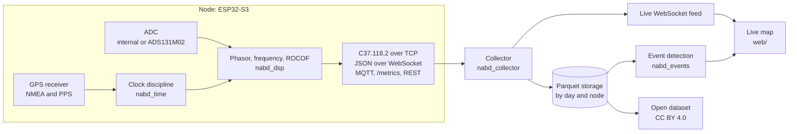

# Architecture

## Node

| Component | Location | Role |
| --- | --- | --- |
| `nabd_time` | `firmware/lib/nabd_time` | Timestamps GPS PPS edges with the CPU cycle counter, estimates oscillator offset and drift, maps local ticks to UTC, and reports lock state, offset, and holdover quality. |
| `nabd_hal` | `firmware/lib/nabd_hal` | `AdcSource` interface with the ESP32-S3 internal ADC and ADS131M02 backends, PPS capture, and the NMEA parser. |
| `nabd_dsp` | `firmware/lib/nabd_dsp` | One-cycle DFT phasor estimation with frequency tracking, frequency and ROCOF from the phase derivative, reporting at 10, 25, or 50 frames per second aligned to UTC second boundaries. |
| `nabd_c37118` | `firmware/lib/nabd_c37118` | IEEE C37.118.2-2011 data, CFG-2, header, and command frames. |
| Application | `firmware/src` | Tasks, networking, provisioning, OTA updates. |

Sampling and DSP run on core 1 and networking on core 0. A lock-free ring buffer carries sample blocks, each with a disciplined timestamp, from the sampling task to the DSP task. The libraries `nabd_dsp`, `nabd_time`, and `nabd_c37118`, and the NMEA parser in `nabd_hal`, contain no ESP-IDF code and are tested on the host with `pio test -e native`.

## Server and clients

| Component | Location | Role |
| --- | --- | --- |
| Collector | `server/nabd_collector` | Accepts C37.118.2 over TCP and JSON over WebSocket, aligns frames from all nodes by timestamp, writes Parquet partitioned by day and node, and serves a live WebSocket feed. |
| Event detection | `server/nabd_events` | Frequency excursions, ROCOF spikes, and inter-node angle oscillations from FFT and matrix pencil analysis of angle differences. |
| Live map | `web/` | Nodes at city level, frequency per node, relative angle to a selectable reference node, event timeline, node health. |
| CLI | `tools/nabd` | Node provisioning, raw serial capture, calibration, dataset export, compliance report. |
| Compliance harness | `compliance/` | Synthetic IEEE C37.118.1 test signals and TVE, FE, and RFE evaluation against P-class limits. |
